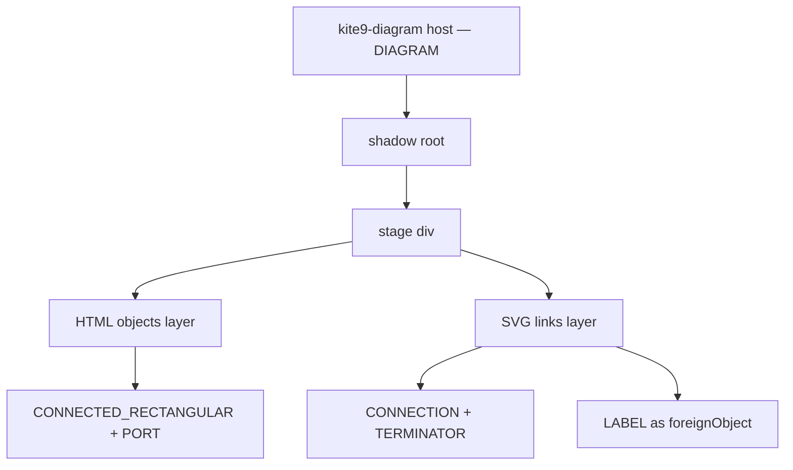
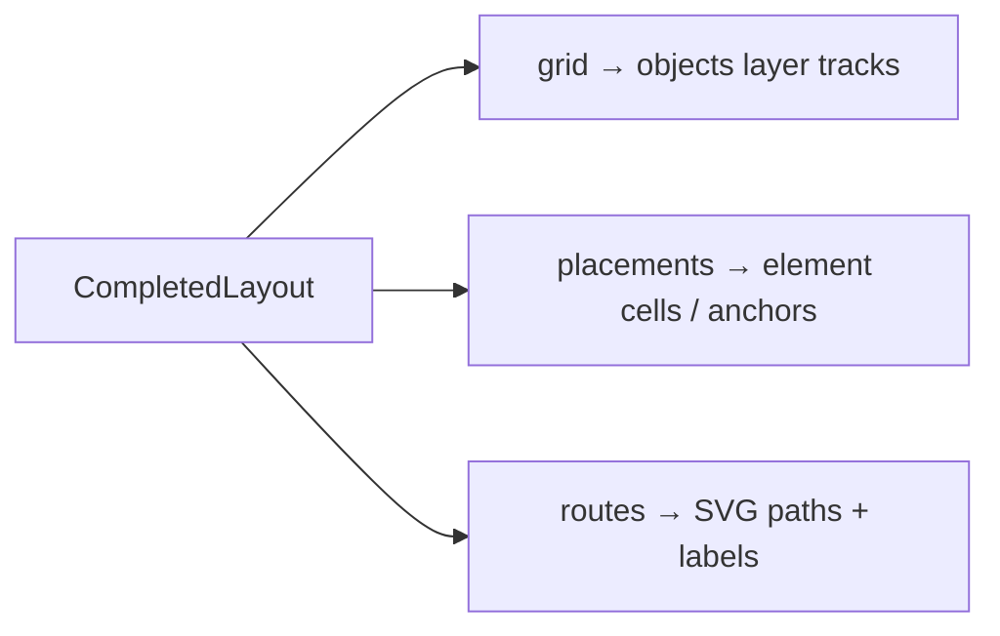

# `@kite9/model`

Logical diagram model for Kite9 — the algorithm- and authoring-facing graph of elements, independent of DOM, CSS, and templates.

This package is **interfaces and geometry/position types**. Style/CSS enums (`DiagramElementType`, alignment, sizing, …) are declared in `@kite9/css` and re-exported from here. Concrete instances are built by `@kite9/templating` from light DOM.

## Type hierarchy

```
DiagramElement
├── Positioned
│   ├── Rectangular          ← containers live here (contents, layout, grid)
│   │   ├── Diagram
│   │   ├── ConnectedRectangular  (= Rectangular + Connected)
│   │   ├── SizedRectangular
│   │   │   └── Terminator
│   │   └── AlignedRectangular
│   │       └── Label
│   ├── Connected
│   │   ├── ConnectedRectangular
│   │   └── Port  (+ PlacementPositioned)
│   └── PlacementPositioned
└── Connection  (extends BiDirectional<Connected>)
```

`Rectangular` is the container: `getContents()`, `getLayout()`, `getGridColumns()` / `getGridRows()`, traversal rules.

Every `DiagramElement` exposes `getType(): DiagramElementType` — one of the six kinds below.

Element kind is determined by the computed CSS custom property `--kite9-type` after templating (see `@kite9/css`). Tag names only select chrome; author styles on the host beat template `:host` defaults via the normal cascade.

## Render layers

| Layer | `DiagramElementType` | Model | HTML/SVG | Render layer |
| --- | --- | --- | --- | --- |
| 0 | `DIAGRAM` | `Diagram` | HTML | Host custom element (e.g. `<kite9-diagram id="diagram-a" theme="designer" mode="edit">`) |
| 1 | `CONNECTED_RECTANGULAR` | `ConnectedRectangular` (containers / glyphs) | HTML | Nested HTML from templates; hierarchy mirrors `Rectangular.getContents()` |
| 1 | `PORT` | `Port` | HTML | On container edges |
| 2 | `CONNECTION` | `Connection` | SVG | SVG layer above the HTML objects layer |
| 2 | `TERMINATOR` | `Terminator` | SVG | Markers at connection ends in the SVG layer |
| 2 | `LABEL` | `Label` (connection label) | SVG | `foreignObject` nodes inside that SVG layer |

`Label` is only a connection endpoint label (`fromLabel` / `toLabel`). Glyph/container titles are template/chrome concerns, not model `Label`s.



## Completed layout

A finished arrangement of a diagram is a `CompletedLayout` (`src/layout.ts`): sized grid tracks, where each element sits, and where each connection is drawn. It is pure data — no DOM — and is what layout algorithms produce and what renderers (e.g. `@kite9/test-template`’s `applyLayout`) consume.

| Field | Type | Role |
| --- | --- | --- |
| `grid` | `GridLayout` | Content grid size plus physical track sizes (`colSizes` / `rowSizes`, including gutters). Drives the HTML objects layer. |
| `placements` | `Record<id, LayoutPlacement>` | Per-element position: either a content-grid cell (`col` / `row` / optional span + `size`) or an edge anchor (`anchor` + `side`, e.g. ports). |
| `routes` | `Record<id, RouteLayout>` | Per-connection polyline (`points`) and label positions in diagram coordinates. Drawn on the SVG links layer. |

SVG layer render inputs (also in `layout.ts`) — what template packs paint under each link `<g>`:

| Type | Role |
| --- | --- |
| `ConnectionRenderLayout` | Link id, polyline points, and `fromStyle` / `toStyle` for path `marker-start` / `marker-end` |
| `TerminatorRenderLayout` | End style (`ARROW` / `NONE`) + `point` for hit-box and shared SVG marker def |
| `LabelRenderLayout` | Label id/end, `point`, and `size` for an SVG `foreignObject` (text from the label host) |



## Light DOM (templated) diagram

A diagram can therefore be described as something like this (see the kite9-templating package):

```xml
<diagram id="pipeline">
  <context id="group">
    <glyph id="ingest" label="Ingest"/>
    <glyph id="transform" label="Transform"/>
  </context>
  <link id="l1">
    <from reference="ingest"/>
    <to reference="transform"/>
  </link>
</diagram>
```
