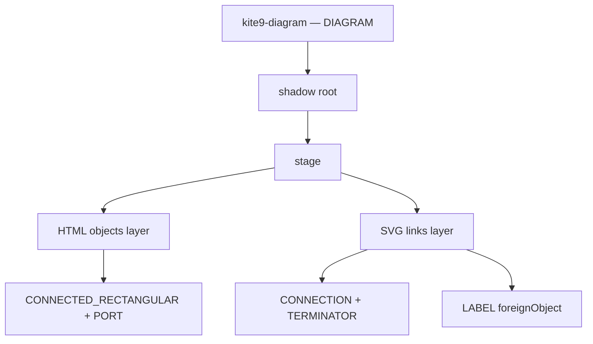
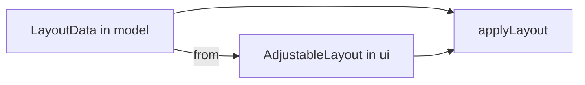

# `@kite9/model`

Logical diagram model for Kite9 — element interfaces, position/geometry types, and serializable **layout snapshots**. No DOM, no templates, no edit mutation.

Style/CSS enums (`DiagramElementType`, alignment, sizing, …) live in `@kite9/css` and are re-exported here. Concrete element instances are built by `@kite9/templating` from light DOM. Edit-time layout changes use **`AdjustableLayout` in `@kite9/ui`**.

## Type hierarchy

```
DiagramElement
├── Positioned
│   ├── Rectangular          ← containers live here (contents, layout, grid)
│   │   ├── Diagram
│   │   ├── ConnectedRectangular  (= Rectangular + Connected)
│   │   ├── SizedRectangular
│   │   │   └── Terminator
│   │   └── AlignedRectangular
│   │       └── Label
│   ├── Connected
│   │   ├── ConnectedRectangular
│   │   └── Port  (+ PlacementPositioned)
│   └── PlacementPositioned
└── Connection  (extends BiDirectional<Connected>)
```

`Rectangular` is the container: `getContents()`, `getLayout()`, `getGridColumns()` / `getGridRows()`, traversal rules.

Every `DiagramElement` exposes `getType(): DiagramElementType` — one of the six kinds below. Kind comes from computed `--kite9-type` after templating (see `@kite9/css`).

## Render layers

| Layer | `DiagramElementType` | Model | HTML/SVG | Render layer |
| --- | --- | --- | --- | --- |
| 0 | `DIAGRAM` | `Diagram` | HTML | Host custom element (e.g. `<kite9-diagram>`) |
| 1 | `CONNECTED_RECTANGULAR` | `ConnectedRectangular` | HTML | Nested hosts; hierarchy mirrors `Rectangular.getContents()` |
| 1 | `PORT` | `Port` | HTML | On container edges |
| 2 | `CONNECTION` | `Connection` | SVG | Links layer above objects |
| 2 | `TERMINATOR` | `Terminator` | SVG | Markers at connection ends |
| 2 | `LABEL` | `Label` | SVG | `foreignObject` in the links layer |

`Label` is only a connection endpoint label (`fromLabel` / `toLabel`). Glyph/container titles are chrome, not model `Label`s.



## Layout data (`src/layout.ts`)

**`LayoutData`** is the serializable arrangement of a diagram: grid tracks, element placements, and link routes. Fixtures and layout algorithms produce it; renderers (e.g. `@kite9/preview` `applyLayout`) consume it.



## Light DOM (templated)

See `@kite9/templating`. Example shape:

```xml
<diagram id="pipeline">
  <context id="group">
    <glyph id="ingest" label="Ingest"/>
    <glyph id="transform" label="Transform"/>
  </context>
  <link id="l1">
    <from reference="ingest"/>
    <to reference="transform"/>
  </link>
</diagram>
```
